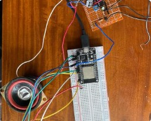
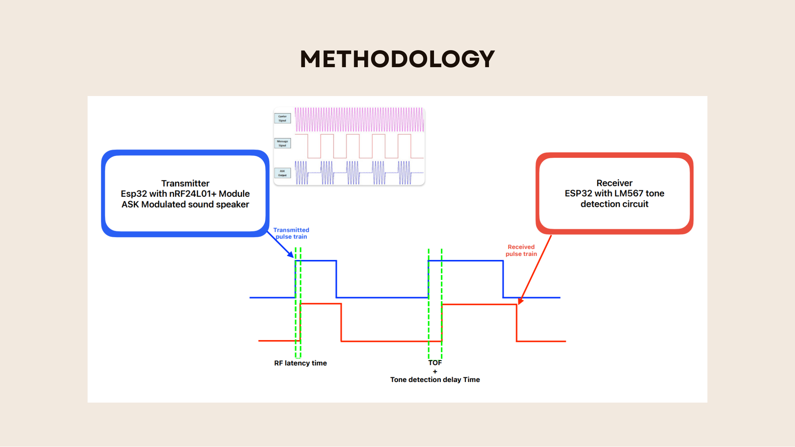
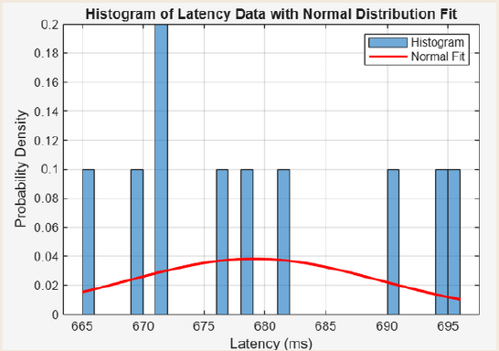
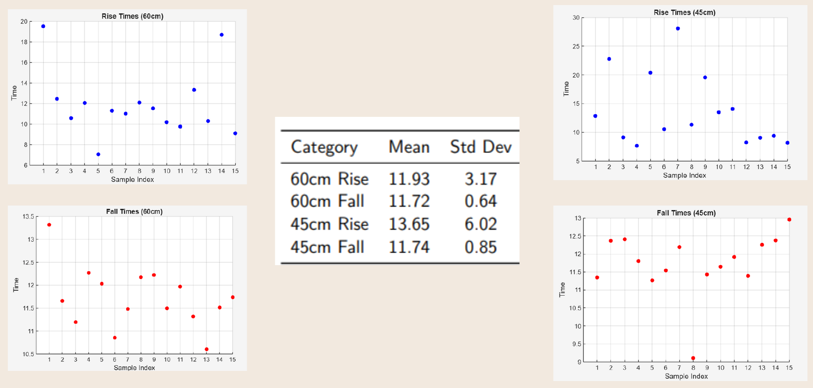

# RF-Synchronized Acoustic Ranging (Sound-Based Navigation)

> A low-cost distance measurement system. An RF packet marks "time zero" and an ASK-modulated sound burst measures acoustic time-of-flight between two separate units. It is an alternative to fixed ultrasonic modules like the HC-SR04.



**Course:** EE254 – Sound-Based Problem Solving Project, Semester 4, University of Peradeniya · **Duration:** May 2025 – Aug 2025
**Team 25:** Harishraj T., Kugaram M., Selvakumar K.
**My role:** Circuit simulation, hardware implementation (with a teammate), and system testing and measurement.

---

## Problem
Distance sensing is central to robotics and automation. Common ultrasonic modules like the HC-SR04 have a fixed frequency, short range and little flexibility. Measuring sound time-of-flight between two separate units needs a shared time reference, and that is the hard part.

## How it works



**Transmitter (ESP32)**
1. Sends a `SYNC` packet over an **nRF24L01+** 2.4 GHz link.
2. Waits a fixed 10 ms, then switches a GPIO that gates the tone generator, producing an **ASK (on-off keyed) sound burst** at **16 kHz**.
3. The burst is amplified by an **LM386** and played through a speaker.

**Receiver (ESP32)**
1. On receiving `SYNC`, starts a **microsecond timer**.
2. A microphone feeds an **LM567 tone decoder**, which switches its digital output only when the correct frequency is present.
3. The ESP32 stops the timer. Distance = speed of sound × flight time, after removing the fixed 10 ms delay, the RF latency and the detector delay.

Sound travels only ~0.343 mm per µs, so every microsecond of timing error matters.

## Components
| Component | Purpose |
|---|---|
| ESP32 ×2 | Transmitter and receiver controllers, µs timing |
| nRF24L01+ ×2 | RF synchronization link |
| Tone generator + LM386 + speaker | ASK sound burst |
| Microphone + LM567 | Frequency-selective tone detection |

Pin connections: [docs/wiring.md](docs/wiring.md)

## Results

### 1. RF sync latency
Measured with a dedicated test (`firmware/latency-test`): a wired GPIO reference pulse is timestamped by an interrupt on the receiver, then compared with the arrival time of an RF packet sent 10 ms later.

| Metric | Value |
|---|---|
| Mean latency | **≈ 679 µs** |
| Range | 665 – 696 µs |
| Std. deviation | ≈ 11 µs |

Raw readings: [data/rf_latency_samples.csv](data/rf_latency_samples.csv)


<sub>Histogram x-axis is in µs (labelled "ms" in the original plot).</sub>

The latency is stable enough to subtract as a fixed offset. Its ±16 µs spread corresponds to only about ±5 mm of distance error.

### 2. Acoustic timing at 45 cm and 60 cm (15 samples each)

| Measurement | Mean (ms) | Std. dev. (ms) |
|---|---|---|
| 60 cm, rising edge | 11.93 | 3.17 |
| 60 cm, falling edge | 11.72 | 0.64 |
| 45 cm, rising edge | 13.65 | 6.02 |
| 45 cm, falling edge | 11.74 | 0.85 |



**What this shows:** each reading includes the 10 ms scheduled delay plus flight time and detector delay. The falling edge is far more repeatable than the rising edge. However, its jitter (σ ≈ 0.6–0.85 ms) is larger than the 0.44 ms flight-time difference between 45 cm and 60 cm. So the RF sync is precise, but the **tone detector's response time is the limiting error source**. That is the key finding, and what a next version must fix.

## Challenges & how we solved them
- **Timer resolution:** an Arduino could not provide reliable microsecond timing. → Moved to the **ESP32**.
- **Unknown RF delay:** → Built a separate wired-reference test to **measure nRF24L01+ latency directly** before trusting it as a time reference.
- **Tone detection (three iterations):**
  1. A **Goertzel filter** on the ESP32 failed because its ADC sample rate was too low for the tone.
  2. An **STM32 as an external ADC/detector** gave inconsistent packet capture and highly variable delays.
  3. The **LM567 tone decoder IC** gave repeatable hardware detection and was used in the final build.

## Limitations & future work
- Detector response jitter currently limits distance resolution to more than 15 cm.
- The firmware prints uncalibrated distance; offsets are removed in analysis.
- The ranging receiver sketch was written during the STM32-detector iteration (it waits for an active-HIGH signal). The LM567's output is normally active-LOW, so the wait condition may need inverting for an LM567-only build.
- Early bench tests used a ~10 kHz tone; the final design uses a 16 kHz carrier.
- Next steps: a faster ADC with digital correlation (matched filter), chirp pulses instead of single tones, temperature compensation for the speed of sound, and multiple receivers for 2D positioning.

## Repository structure
```
├── firmware/
│   ├── latency-test/   # latency_tx, latency_rx — measures RF latency
│   └── ranging/        # ranging_tx, ranging_rx — full ToF system
├── data/               # rf_latency_samples.csv
├── docs/               # slides.pdf, wiring.md, diagrams and plots
└── media/              # prototype photo
```

## How to run
1. Install the Arduino IDE with **ESP32 board support** and the **RF24** library (TMRh20).
2. Wire both boards as in `docs/wiring.md`.
3. Flash `*_tx` to one ESP32 and `*_rx` to the other.
4. Open the Serial Monitor at **115200 baud** on the receiver.

## Acknowledgements
Teammates Kugaram M. and Selvakumar K., and the EE254 course staff, Department of EEE, University of Peradeniya.
